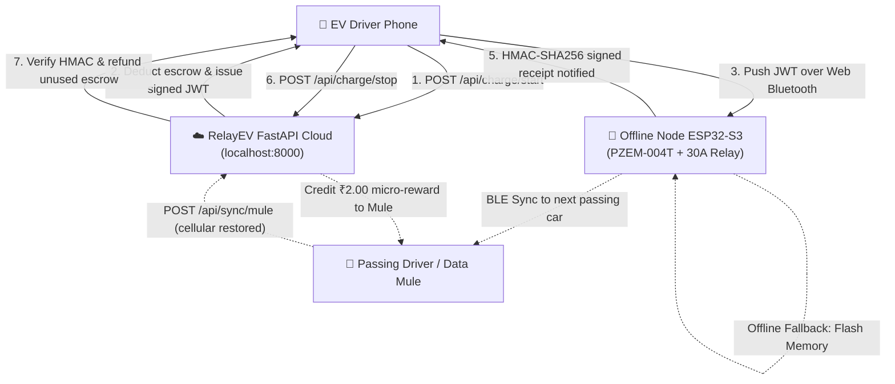

# RelayEV: Offline-First Rural EV Charging Mesh

> **Decentralized, Peer-to-Peer EV charging infrastructure engineered for rural India and cellular dead zones.**  
> Eliminates ₹150,000+ commercial DC fast chargers and recurring 4G SIM OPEX with a **₹1,500 open-hardware node** using cryptographic escrow over Web Bluetooth (WebBLE) and self-healing **Drive-By Data Mules**.

---

## 💡 The Problem & The Breakthrough

1. **Cellular Dead Zones**: 60%+ of rural transit corridors lack stable 4G/5G cellular coverage. Conventional cloud-dependent chargers immediately fail when internet connectivity drops.
2. **Expensive Infrastructure**: Commercial EV chargers cost ₹150,000 to ₹1,300,000 upfront plus recurring monthly data SIM fees, making rural hosting economically unfeasible.
3. **The RelayEV Breakthrough**:
   - **Zero-OPEX Hardware**: Operates without host Wi-Fi or cellular modems.
   - **Cryptographic Offline Escrow**: Uses backend-signed JWT vouchers pushed over Web Bluetooth to close the 30A relay locally.
   - **Drive-By Data Mules**: Stranded offline receipts stored on ESP32 flash memory are uploaded by passing smartphones, creating a self-healing mesh with micro-incentives (₹2.00 INR per voucher).

---

## 🏗️ System Architecture



---

## 📁 Repository Structure

```text
RelayEV/
├── backend/                       # Python FastAPI Backend Engine
│   ├── main.py                    # API routes (Escrow, Mules, Wallet, Nodes)
│   ├── config.py                  # Secrets, algorithms, and token expiry limits
│   ├── database.py                # SQLite WAL & Supabase PostgreSQL manager
│   ├── security.py                # JWT generation & HMAC-SHA256 verification
│   ├── schemas.py                 # Pydantic v2 validation models
│   ├── schema.sql                 # Supabase PostgreSQL schema with RLS
│   ├── requirements.txt           # Python dependencies
│   ├── test_backend.py            # 14 Pytest automated tests
│   └── Dockerfile                 # Python 3.12-slim production container
├── firmware/                      # ESP32 & ESP32-S3 Physical Hardware Firmware
│   ├── esp32_relay_node/
│   │   ├── esp32_relay_node.ino   # Master sketch (Setup, loop, serial CLI)
│   │   ├── config.h               # Hardware pinout, tariff, and BLE UUIDs
│   │   ├── ble_manager.h/.cpp     # WebBLE GATT server & notification dispatcher
│   │   ├── pzem_meter.h/.cpp      # Peacefair PZEM-004T v3.0 Modbus-RTU driver
│   │   ├── relay_controller.h/.cpp# 30A relay failsafe & cutoff logic
│   │   ├── crypto_engine.h/.cpp   # On-chip mbedtls HMAC-SHA256 & JWT verification
│   │   ├── storage_manager.h/.cpp # SPIFFS offline flash buffer for Data Mules
│   │   ├── platformio.ini         # PlatformIO build configuration
│   │   └── README.md              # BOM, schematics, and flashing guide
│   └── test_firmware_crypto.py    # Automated firmware & cloud verification suite
├── frontend/                      # Next.js 16 App Router UI (PWA & Standalone)
│   ├── public/
│   │   ├── manifest.json          # Web App Manifest
│   │   ├── sw.js                  # PWA offline service worker
│   │   └── icons/                 # PWA icons (192x192, 512x512)
│   ├── src/
│   │   ├── app/
│   │   │   ├── page.tsx           # Community map & sliding Station Drawer
│   │   │   ├── charge/page.tsx    # Direct /charge WebBLE & Simulator testing
│   │   │   ├── host/page.tsx      # Host Node Dashboard & Instant UPI Payouts
│   │   │   ├── mule/page.tsx      # Drive-By Data Mule Portal & Micro-Bounties
│   │   │   └── manifest.ts        # Dynamic Next.js metadata manifest
│   │   ├── components/
│   │   │   ├── Navigation.tsx     # Global responsive top navigation bar
│   │   │   ├── PwaBanner.tsx      # Offline mesh mode badge & 1-tap install
│   │   │   ├── OfflineMeshContext.tsx # Network online/offline event dispatcher
│   │   │   ├── BleConnector.tsx   # Native Web Bluetooth (WebBLE)
│   │   │   ├── BleSimulator.tsx   # Mock ESP32 Hardware Simulator
│   │   │   └── ChargingSessionManager.tsx # Escrow & settlement orchestrator
│   │   └── lib/
│   │       ├── offlineMeshStorage.ts # Offline receipt queue in dead zones
│   │       ├── bleService.ts      # Web Bluetooth GATT service driver
│   │       └── crypto.ts          # Browser Web Crypto HMAC-SHA256 generator
│   ├── Dockerfile                 # Multi-stage Next.js standalone container
│   └── package.json
├── nginx/
│   └── nginx.conf                 # Edge reverse proxy configuration
├── scripts/
│   ├── migrate_supabase.py        # Cloud PostgreSQL migration engine
│   ├── test_pwa_offline_mesh.py   # PWA & offline sync verification
│   └── test_host_and_mule_portal.py # Host payouts & Data Mule verification
├── docker-compose.yml             # Single-command production stack
├── docker-compose.dev.yml         # Development stack with hot-reloading
├── test_lifecycle.py              # End-to-end integration test suite
├── DEPLOYMENT.md                  # Comprehensive Cloud & VPS deployment guide
└── README.md                      # Project Overview
```

---

## 🚀 Quickstart

### 1. Full-Stack Single-Command Deployment (Docker)
```bash
docker compose up -d --build
```
- Web Application: **[http://localhost](http://localhost)**
- Interactive API Docs: **[http://localhost/docs](http://localhost/docs)**

### 2. Manual Development Setup

#### Backend (FastAPI):
```powershell
cd backend
python -m pip install -r requirements.txt
python -m pytest test_backend.py -v
python -m uvicorn main:app --host 0.0.0.0 --port 8000 --reload
```

#### Frontend (Next.js 16 PWA):
```powershell
cd frontend
npm install
npm run dev
```
Open **[http://localhost:3000](http://localhost:3000)** in Chrome or Edge.

### 3. Firmware Flashing (ESP32)
```powershell
cd firmware/esp32_relay_node
pio run -t upload
pio device monitor -b 115200
```
