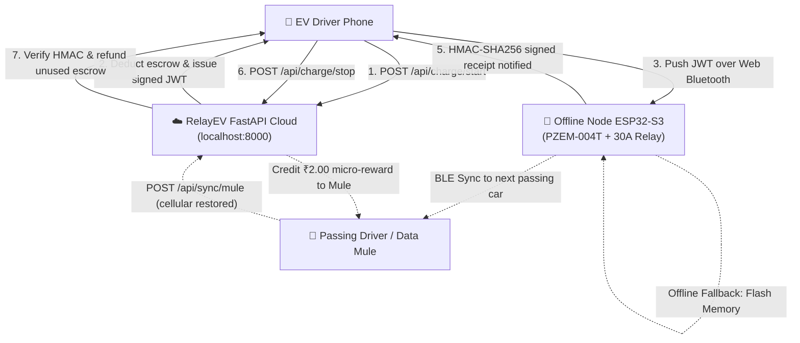

# RelayEV: Offline-First Rural EV Charging Mesh

> **Decentralized, Peer-to-Peer EV charging infrastructure engineered for rural India and cellular dead zones.**  
> Eliminates ₹150,000+ commercial DC fast chargers and recurring 4G SIM OPEX with a **₹1,500 open-hardware node** using cryptographic escrow over Web Bluetooth (WebBLE) and self-healing **Drive-By Data Mules**.

---

## 💡 The Problem & The Breakthrough

1. **Cellular Dead Zones**: 60%+ of rural transit corridors lack stable 4G/5G cellular coverage. Conventional cloud-dependent chargers immediately fail when internet connectivity drops.
2. **Expensive Infrastructure**: Commercial EV chargers cost ₹150,000 to ₹1,300,000 upfront plus recurring monthly data SIM fees, making rural hosting economically unfeasible.
3. **The RelayEV Breakthrough**:
   - **Zero-OPEX Hardware**: Operates without host Wi-Fi or cellular modems.
   - **Cryptographic Offline Escrow**: Uses backend-signed JWT vouchers pushed over Web Bluetooth to close the 30A relay locally.
   - **Drive-By Data Mules**: Stranded offline receipts stored on ESP32 flash memory are uploaded by passing smartphones, creating a self-healing mesh with micro-incentives.

---

## 🏗️ System Architecture



---

## 📁 Repository Structure

```text
RelayEV/
├── backend/                       # Python FastAPI Backend Engine
│   ├── main.py                    # API routes (Escrow, Mules, Wallet, Nodes)
│   ├── config.py                  # Secrets, algorithms, and token expiry limits
│   ├── database.py                # SQLite WAL & Supabase PostgreSQL manager
│   ├── security.py                # JWT generation & HMAC-SHA256 verification
│   ├── schemas.py                 # Pydantic v2 validation models
│   ├── schema.sql                 # Supabase PostgreSQL schema with RLS
│   ├── requirements.txt           # Python dependencies
│   ├── test_backend.py            # 14 Pytest automated tests
│   └── README.md                  # In-depth backend technical documentation
├── firmware/                      # ESP32 & ESP32-S3 Physical Hardware Firmware
│   ├── esp32_relay_node/
│   │   ├── esp32_relay_node.ino   # Master sketch (Setup, loop, serial CLI)
│   │   ├── config.h               # Hardware pinout, tariff, and BLE UUIDs
│   │   ├── ble_manager.h/.cpp     # WebBLE GATT server & notification dispatcher
│   │   ├── pzem_meter.h/.cpp      # Peacefair PZEM-004T v3.0 Modbus-RTU driver
│   │   ├── relay_controller.h/.cpp# 30A relay failsafe & cutoff logic
│   │   ├── crypto_engine.h/.cpp   # On-chip mbedtls HMAC-SHA256 & JWT verification
│   │   ├── storage_manager.h/.cpp # SPIFFS offline flash buffer for Data Mules
│   │   ├── platformio.ini         # PlatformIO build configuration
│   │   └── README.md              # BOM, schematics, and flashing guide
│   └── test_firmware_crypto.py    # Automated firmware & cloud verification suite
├── frontend/                      # Next.js 16 App Router UI
│   ├── src/
│   │   ├── app/
│   │   │   ├── page.tsx           # Community map & sliding Station Drawer
│   │   │   └── charge/            # Dedicated /charge direct testing route
│   │   ├── components/
│   │   │   ├── BleConnector.tsx   # Real Web Bluetooth (WebBLE)
│   │   │   ├── BleSimulator.tsx   # Mock ESP32 Hardware Simulator
│   │   │   └── ChargingSessionManager.tsx # Escrow & settlement orchestrator
│   │   ├── lib/
│   │   │   ├── bleService.ts      # Web Bluetooth GATT service driver
│   │   │   ├── crypto.ts          # Browser Web Crypto HMAC-SHA256 generator
│   │   │   └── supabaseClient.ts  # Supabase client initialization
│   │   └── types/ble.ts           # GATT UUIDs and telemetry interfaces
│   └── package.json
├── test_lifecycle.py              # End-to-end integration test suite
└── README.md                      # Project Overview
```

---

## 🚀 Quickstart

### 1. Backend Setup & Test Suite
```powershell
cd backend
python -m pip install -r requirements.txt
python -m pytest test_backend.py -v
python -m uvicorn main:app --host 0.0.0.0 --port 8000 --reload
```
Interactive Swagger API docs: **[http://localhost:8000/docs](http://localhost:8000/docs)**

### 2. Frontend Setup
```powershell
cd frontend
npm install
npm run dev
```
Open **[http://localhost:3000](http://localhost:3000)** in Google Chrome or Microsoft Edge.

### 3. Firmware Flashing & Verification
```powershell
# Run the firmware cryptographic verification suite
python firmware/test_firmware_crypto.py

# Flash firmware to physical ESP32 using PlatformIO
cd firmware/esp32_relay_node
pio run -t upload
pio device monitor -b 115200
```
