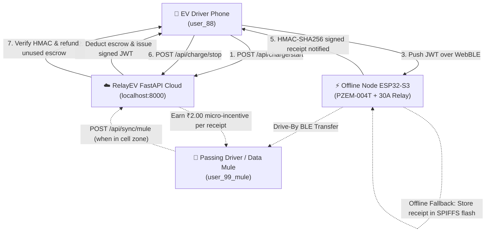

# RelayEV Backend: Cryptographic Escrow & Drive-By Data Mule Mesh

**RelayEV** is an offline-first rural EV charging mesh designed specifically for cellular dead zones and high-reliability, zero-OPEX community micro-grids.

This repository houses the complete **Python FastAPI backend engine**, providing the financial escrow engine, cryptographic signature verification, replay attack prevention, and the Drive-By Data Mule synchronization mesh.

---

## 🏛️ System Architecture



---

## 🛠️ Tech Stack & Key Files

- **Framework**: Python 3.14 / FastAPI 0.162+
- **Security & Cryptography**: PyJWT (HS256 tokens), HMAC-SHA256 hardware verification
- **Database**: Dual-engine architecture:
  - **SQLite WAL Mode** (`relay_ev.db`) with foreign key enforcement for instant zero-dependency deployment.
  - **Supabase / PostgreSQL** migration script (`schema.sql`) with RLS policies for cloud production.
- **Testing**: `pytest` comprehensive automated test suite (14/14 passing).

| File | Purpose |
|---|---|
| [`main.py`](file:///d:/RelayEV/backend/main.py) | FastAPI application endpoints, routers, CORS middleware, and lifespan handlers. |
| [`config.py`](file:///d:/RelayEV/backend/config.py) | Configuration, environment variables, secrets, and token expiry limits. |
| [`database.py`](file:///d:/RelayEV/backend/database.py) | Database manager with thread-safe connection pooling, atomic transactions, and audit ledger. |
| [`security.py`](file:///d:/RelayEV/backend/security.py) | Cryptographic utilities: JWT token generation/validation, hardware HMAC-SHA256 verification, and metering tamper checks. |
| [`schemas.py`](file:///d:/RelayEV/backend/schemas.py) | Pydantic v2 validation models for all request payloads and API responses. |
| [`schema.sql`](file:///d:/RelayEV/backend/schema.sql) | Production PostgreSQL schema ready for Supabase SQL Editor. |
| [`test_backend.py`](file:///d:/RelayEV/backend/test_backend.py) | Automated test suite validating financial transactions, anti-replay, and mule syncing. |

---

## 🔑 Core API Endpoints

### 1. Escrow Engine

#### `POST /api/charge/start`
Locks driver funds into escrow and generates a backend-signed JWT session voucher.
```json
// Request
{
  "user_id": "user_88",
  "node_id": "RelayEV-Node-01",
  "escrow_amount": 100.00
}

// Response
{
  "session_id": "REV-7A1B2C3D4E",
  "user_id": "user_88",
  "node_id": "RelayEV-Node-01",
  "node_name": "Mohan's Courtyard Node",
  "escrow_amount": 100.0,
  "rate_per_kwh": 10.0,
  "max_energy_kwh": 10.0,
  "session_token": "eyJhbGciOiJIUzI1Ni...",
  "user_remaining_balance": 400.0,
  "issued_at": 1793017800,
  "expires_at": 1793025000
}
```

#### `POST /api/charge/stop` (or `/api/charge/settle`)
Verifies the ESP32 hardware HMAC signature, settles the session, calculates the refund, and updates balances.
```json
// Request
{
  "session_id": "REV-7A1B2C3D4E",
  "node_id": "RelayEV-Node-01",
  "user_id": "user_88",
  "energy_consumed_kwh": 8.42,
  "actual_cost": 84.20,
  "node_signature": "2627a66b58e4a61926d954c28f93d4490c9d39a8491f9004631eda8df95ec9ce",
  "timestamp": 1793018200,
  "nonce": "nonce_7f29a01b"
}

// Response
{
  "session_id": "REV-7A1B2C3D4E",
  "status": "SETTLED",
  "escrow_amount": 100.0,
  "actual_cost": 84.2,
  "refund_amount": 15.8,
  "energy_consumed_kwh": 8.42,
  "user_new_balance": 415.8,
  "host_earnings": 84.2,
  "signature_verified": true,
  "synced_via": "DIRECT_PHONE",
  "message": "Session settled successfully via DIRECT_PHONE. Refund of ₹15.80 credited to wallet."
}
```

#### `POST /api/charge/cancel`
Aborts an unredeemed session (e.g. driver was unable to pair with BLE node) and returns a 100% refund.

---

### 2. Drive-By Data Mule Mesh Sync (`/api/sync/mule`)
When passing phones carrying offline receipts reach cellular reception, they upload batches to sync stranded sessions.
```json
// Request
{
  "mule_user_id": "user_99_mule",
  "receipts": [
    {
      "session_id": "REV-OFFLINE-01",
      "node_id": "RelayEV-Node-01",
      "user_id": "user_88",
      "energy_consumed_kwh": 3.0,
      "actual_cost": 30.0,
      "node_signature": "...",
      "timestamp": 1793018000,
      "nonce": "mule_nonce_1"
    }
  ]
}

// Response
{
  "mule_user_id": "user_99_mule",
  "synced_count": 1,
  "duplicate_count": 0,
  "mule_reward_inr": 2.0,
  "mule_new_balance": 52.0,
  "details": [...],
  "message": "Synced 1 offline receipts (0 duplicates skipped). Data Mule rewarded ₹2.00!"
}
```

---

### 3. Driver & Node Management Endpoints
- `GET /api/user/me?user_id=user_88` - Driver profile and current balance.
- `POST /api/user/topup` - Add funds to wallet.
- `GET /api/user/transactions` - Transaction history.
- `GET /api/user/ledger` - Immutable double-entry wallet ledger.
- `GET /api/nodes` - List active mesh nodes.
- `POST /api/nodes/register` - Register a new host node.
- `POST /api/nodes/{node_id}/payout` - Withdraw host earnings to UPI.
- `GET /api/health` - System health check and database statistics.

---

## 🔒 Cryptographic Specifications

### 1. Hardware Signature Formula
The ESP32 PZEM-004T AC meter computes an HMAC-SHA256 signature using the node's hardware secret:
$$\text{Signature} = \text{HMAC-SHA256}(\text{SecretKey}, \texttt{session\_id:energy\_kwh:actual\_cost})$$
Where:
- `energy_kwh` is formatted to 3 decimal places (`f"{kwh:.3f}"`)
- `actual_cost` is formatted to 2 decimal places (`f"{cost:.2f}"`)

### 2. Anti-Replay Protection
Every receipt contains a unique cryptographic `nonce`. The database atomically records the nonce in the `nonces` table upon settlement. Subsequent submissions with the same nonce are rejected with `HTTP 400 Bad Request (Replay attack detected)`.

---

## 🧪 Running the Test Suite

Run the full automated test suite using `pytest`:
```powershell
cd D:\RelayEV\backend
python -m pytest test_backend.py -v
```

Expected result:
```text
======================== 14 passed in 2.61s ========================
```

---

## 🚀 Running the Production Backend Server

```powershell
cd D:\RelayEV\backend
python -m uvicorn main:app --host 0.0.0.0 --port 8000 --reload
```
Interactive Swagger API documentation is available at:
**[http://localhost:8000/docs](http://localhost:8000/docs)**
